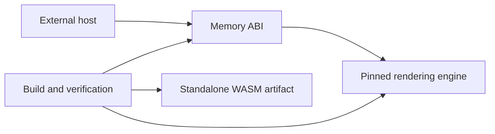

# Architecture

Mermaid WASM converts Mermaid source into SVG text inside a standalone WebAssembly
module. The host owns loading, UTF-8 encoding, memory transfers, scheduling, and
display. The renderer performs parsing, text measurement, layout, and serialization
without host services. The boundary is specified in [Memory ABI](contracts.md).

## Components

### Memory ABI

Owns `src/lib.rs`. Manages input and result allocations, validates UTF-8 and source
length, and translates the rendering engine's results into the host contract. Talks
to the external host through exported memory and to the Pinned rendering engine
through its Rust API.

### Pinned rendering engine

Owns the external Merman dependency selected by `Cargo.toml` and resolved by
`Cargo.lock`. Provides Mermaid parsing, deterministic text measurement, layout,
and SVG serialization. Talks only to Memory ABI; no runtime host callbacks or asset
loading are permitted. Selection rationale is in [Rendering engine](rendering-engine.md).

### Build and verification

Owns `scripts/`, `tests/`, `Makefile`, `rust-toolchain.toml`, and `.github/workflows/`.
Compiles the artifact, verifies its import/export boundary, packages upstream
notices, and exercises the actual WASM via a test-only host. Talks to Memory ABI
through the compiled artifact. Test JavaScript is not part of the renderer.

## Constraints

- The runtime deliverable is one WASM file with no imports: no browser DOM,
  JavaScript bindings, WASI, system clock, network, or filesystem services.
- Rust dependencies are permitted and locked. This replaces the original Go-only,
  standard-library-only template constraint by the user's explicit selection.
- Rendering uses deterministic engine defaults. Math typesetting is disabled;
  all engine diagram-family features and both optional layout engines are enabled.
- The host owns SVG display policy. Returning SVG does not certify safe insertion
  into an arbitrary document.
- Specs and corresponding behavior changes land together.
